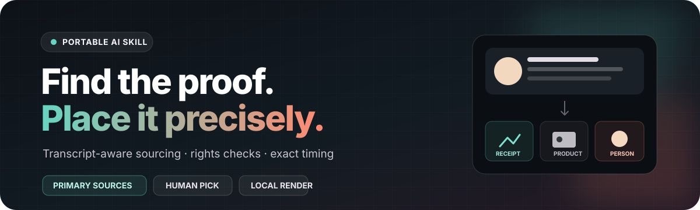
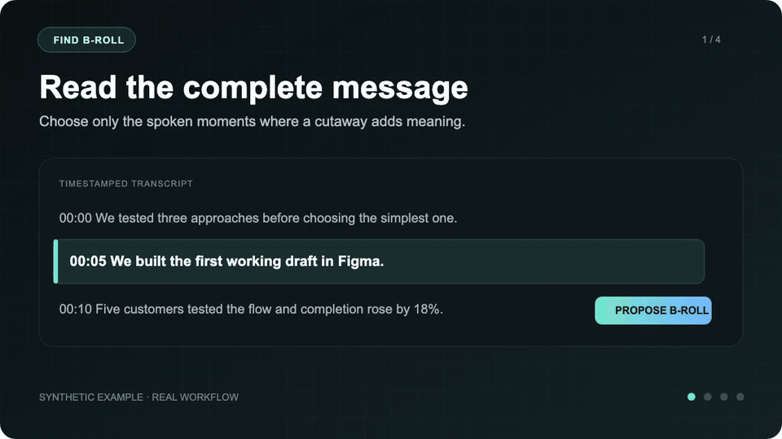
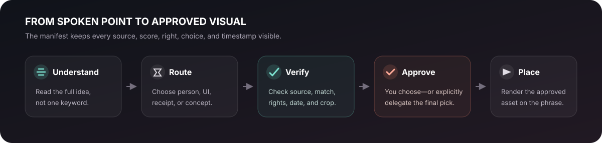

<p align="center">
  
</p>

# Find B-Roll

An original, portable AI skill for finding accurate B-roll and timing approved visuals to spoken video.

Give your agent a transcript or recording. `$find-b-roll` understands what each useful passage means, routes it to the right kind of visual, finds a small set of evidence-backed candidates, records usage rights, and lets you approve the choices before anything is rendered.

**Works with Codex, Claude Code, and other agents that support `SKILL.md` skills.**

## See it work

<p align="center">
  <a href="assets/demo.mp4?raw=1">
    
  </a>
</p>

<p align="center"><sub>Synthetic example, real workflow. Click the animation for the higher-quality MP4.</sub></p>

The walkthrough shows the full decision path: select a useful spoken beat, route its meaning, compare a small rights-aware candidate set, approve one local asset, and time it precisely before rendering a separate review copy.

## What makes it useful

`$find-b-roll` is designed for videos where the visual should be *correct*, not merely decorative:

- podcast and interview introductions;
- tutorials and product explainers;
- founder stories and company profiles;
- commentary built around headlines, claims, or statistics;
- documentaries and educational videos;
- short-form talking-head videos.

It handles named people, actual product interfaces, original posts, official announcements, licensed stock, public-domain archives, and simple original graphics.

For pure mood montages, the skill can prepare options—but it keeps the final taste decision with you.

## Try it

Attach a transcript or point your agent to a video:

```text
Use $find-b-roll for this talking-head video.
Plan the strongest cutaway moments, find two or three accurate candidates
for each, and show me the rights status before I choose anything.
```

The agent returns a beat-by-beat review:

| Spoken beat | Visual intent | Route | Candidate decision |
|---|---|---|---|
| “Our first prototype was built in Figma” | Show the real working canvas | Product/UI | Owned screen recording |
| “Five customers tested the flow” | Illustrate testing without implying these are the actual customers | Location/action | Licensed usability footage |
| “Completion increased by 18%” | Prove the number and explain the measurement | Receipt | Original analytics capture |

Every candidate includes its original URL, publisher, capture date, rights status, scoring breakdown, and local asset path when available.

<p align="center">
  
</p>

## Example prompts

### Podcast introduction

```text
Use $find-b-roll on this podcast intro.
Find accurate visuals for the guest, company, product, and credentials.
Prefer official sources and let me approve the candidate sheet.
```

### Product tutorial

```text
Use $find-b-roll for this tutorial.
Prioritize owned screen recordings and official product media.
Do not use generic technology stock when the actual interface is available.
```

### Evidence-heavy commentary

```text
Use $find-b-roll to support the claims in this script.
Find the original announcements, reports, posts, and headlines.
Record the publication dates and do not substitute secondary screenshots
when a primary source exists.
```

### Plan only

```text
Use $find-b-roll to create a B-roll plan from this transcript.
Do not search or download anything yet. Mark the route, timing,
visual intent, and search query for every proposed beat.
```

### Render approved local assets

```text
Use $find-b-roll with this approved manifest and local asset folder.
Validate rights and timing, render a separate review copy,
and verify every cutaway against the spoken phrase.
```

## How it chooses the right visual

| Route | Trigger | Preferred visual |
|---|---|---|
| `person` | A named person or role | Official profile, press image, licensed interview, owned footage |
| `product-ui` | A tool, product, or workflow | Actual interface, owned screen recording, official product media |
| `receipt` | A claim, quote, statistic, or current event | Original post, primary report, official announcement |
| `location-action` | A place, action, or environment | Licensed stock, owned footage, public-domain media |
| `archival` | A historical person, product, or event | Rights-cleared archive |
| `concept` | An abstract process or idea | Original graphic, diagram, or approved metaphor |
| `reaction` | Humor or emotional punctuation | User-owned or user-selected reaction library |

The skill first asks what the spoken passage is actually communicating. It then searches for that meaning—not the nearest keyword.

## A plan-first workflow

1. Read the complete transcript and state the thesis, audience, and tone.
2. Choose only moments where B-roll adds identity, evidence, comprehension, or deliberate pacing.
3. Write an explicit manifest with timestamps, spoken text, intent, route, and search queries.
4. Get plan approval before broad sourcing.
5. Find two to four strong candidates and visually inspect each one.
6. Score accuracy, authority, rights, clarity, format fit, and freshness.
7. Present a local contact sheet or linked candidate review.
8. Render only approved local assets, then check every placement.

## Candidate scoring

Every candidate receives a transparent score out of 100:

| Dimension | Points |
|---|---:|
| Accuracy to the spoken point | 30 |
| Source authority | 20 |
| Rights confidence | 20 |
| Visual clarity | 15 |
| Format and crop fit | 10 |
| Freshness when relevant | 5 |

A high score cannot rescue misleading content or unclear rights. Those candidates are rejected before recommendation.

## Install

Requirements for the local review tools:

- Python 3.10 or newer;
- `ffmpeg` and `ffprobe`;
- web or browser access in the host agent for online discovery;
- access to any licensed media libraries you want the agent to search.

Clone the repository:

```bash
git clone https://github.com/RBYHNDRDS/find-b-roll.git
cd find-b-roll
```

### Codex

```bash
mkdir -p "${HOME}/.codex/skills"
ln -s "${PWD}" "${HOME}/.codex/skills/find-b-roll"
```

### Claude Code

```bash
mkdir -p "${HOME}/.claude/skills"
ln -s "${PWD}" "${HOME}/.claude/skills/find-b-roll"
```

For another skill-compatible agent, place this repository in—or link it from—that agent’s skills directory. There is no model-specific branch.

## The explicit manifest

The manifest keeps research and editing decisions auditable:

```json
{
  "schema": 1,
  "project": "Tutorial intro",
  "source_duration": 24.6,
  "target": {"width": 1080, "height": 1920},
  "beats": [
    {
      "id": "beat-01",
      "start": 2.4,
      "end": 5.2,
      "spoken_text": "We built the first draft in Figma.",
      "intent": "Show the actual design canvas.",
      "route": "product-ui",
      "queries": ["Figma official product UI design canvas"],
      "status": "planned",
      "candidates": []
    }
  ]
}
```

See [the complete schema and example](references/manifest-schema.md).

## Optional manual tools

Validate or summarize a manifest:

```bash
python3 scripts/broll_manifest.py validate examples/manifest.example.json
python3 scripts/broll_manifest.py summary examples/manifest.example.json
```

Check a candidate score:

```bash
python3 scripts/broll_manifest.py score \
  --accuracy 28 --authority 20 --rights 20 \
  --clarity 14 --format 9 --freshness 5
```

Create a local review page:

```bash
python3 scripts/contact_sheet.py \
  broll_work/manifest.json broll_work/review
```

Render approved local files over the source:

```bash
python3 scripts/render_broll.py \
  source.mp4 broll_work/manifest.json output-broll-review.mp4
```

The scripts do not search the internet or download media. Discovery happens through the host agent’s authorized tools; the scripts validate the record, generate local previews, and render approved files.

## Rights, privacy, and safety

- A public webpage is treated as findable—not automatically reusable.
- Every candidate records rights evidence or an unresolved rights warning.
- Rendering blocks unknown or review-only rights by default.
- No scraper, downloader, API key, telemetry, or network request is bundled.
- Private video, audio, transcripts, and local candidates remain on the machine.
- The source recording is never replaced.
- Existing review pages and outputs are protected from accidental overwrites.
- B-roll audio is ignored; the source audio remains the master track.
- The renderer validates timestamps, asset paths, dimensions, duration, and output sync.

## What is included

```text
find-b-roll/
├── SKILL.md
├── agents/openai.yaml
├── assets/
│   ├── demo.gif
│   ├── demo.mp4
│   ├── hero.svg
│   └── workflow.svg
├── examples/manifest.example.json
├── references/manifest-schema.md
└── scripts/
    ├── broll_manifest.py
    ├── contact_sheet.py
    └── render_broll.py
```

## License

Original implementation by Ruby Hoenderdos, released under the [MIT License](LICENSE).
