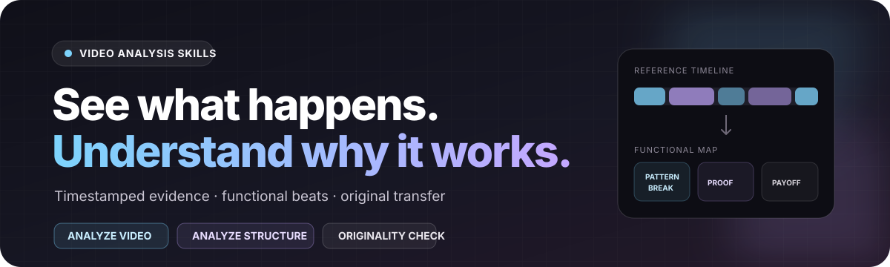
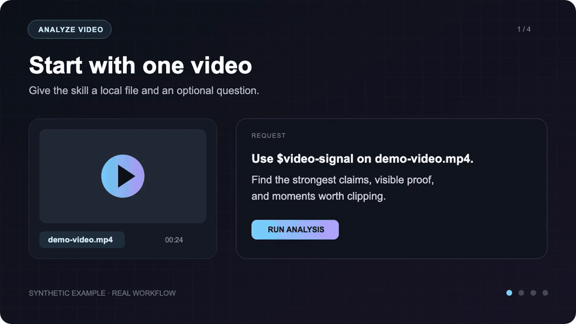

<p align="center">
  
</p>

# Video Analysis Skills

Portable AI skills for understanding what happens in a video—and why its structure works.

Use `$video-signal` for evidence-based video understanding. Use `$analyze-structure` to break a high-performing reference into transferable beats, then build an original script without copying its language.

**Works with Codex, Claude Code, and other agents that support `SKILL.md` skills.**

## See Analyze Video work

<p align="center">
  <a href="assets/demo.mp4?raw=1">
    
  </a>
</p>

<p align="center"><sub>Synthetic example, real workflow. Click the animation for the higher-quality MP4.</sub></p>

The walkthrough shows the full `$video-signal` path: one local video and an optional question go in, the selected file is uploaded to Gemini, and a structured evidence-conscious report comes back. The source video is not edited.

## Choose the analysis

| Skill | Give it | It returns |
|---|---|---|
| [Analyze Video (`$video-signal`)](SKILL.md) | One local video and an optional question | A structured report explaining what happens, what is said and shown, and which moments matter |
| [`$analyze-structure`](skills/analyze-structure/SKILL.md) | A timestamped transcript, video, or authorized source | A functional beat map, pacing analysis, original structure-transfer draft, report, and optional teleprompter |

The two skills work independently. When both are installed, `$video-signal` can provide source observations before `$analyze-structure` maps the narrative.

## Analyze Video (`$video-signal`)

This skill answers: **What happens in this video, what is said and shown, and what should I do with it?**

Give it one local video and, optionally, a specific question. It validates and uploads that file to Gemini through the official `google-genai` SDK, waits for processing, and returns a markdown analysis.

### What the default report contains

| Section | What you get |
|---|---|
| Executive summary | What happens, the likely purpose, and the main takeaway |
| Approximate timeline | Scene changes, visible actions, on-screen text, people, products, and settings |
| Audio and speech | A spoken-content outline plus notes about music, silence, and unclear audio |
| Visual details | UI, gestures, camera movement, edits, overlays, and notable objects |
| Key moments | Potential clips, quotes, proof points, questions, and moments to investigate |
| Practical uses | Ideas for an SOP, ad teardown, recap, brief, or content asset |

Example:

```text
Use $video-signal on this product demo.
Create a timestamped report of the workflow, visible UI,
customer claims, proof, and strongest moments for short-form clips.
```

You can replace the default report with a focused request:

```text
Use $video-signal on this screen recording.
List each action the presenter takes, the visible control they use,
and an approximate timestamp. Mark anything you cannot see clearly.
```

### What it does not do

- It does not cut, caption, reframe, render, or modify the video.
- It does not guarantee verbatim transcription or frame-accurate timestamps.
- It does not analyze an entire folder in one run.
- It is not local-only: the selected video is uploaded to Gemini.

Use exact transcription or editing tools after the analysis when wording and edit points must be precise.

## Analyze Structure

`$analyze-structure` studies the *job* performed by each passage in a reference video.

It records:

- the opening contract and promised payoff;
- functional beats such as pattern break, problem, proof, mechanism, step, reveal, or CTA;
- the audience’s question before and after each beat;
- pacing, duration, information gain, and transitions;
- the retention pressures that keep the next line necessary;
- a new script that preserves only the abstract sequence and timing.

It deliberately does **not** imitate the creator’s wording, catchphrases, examples, facts, or persona.

Example:

```text
Use $analyze-structure on this reference video.
Show me why the opening holds attention, map every structural beat,
then transfer only the functions and pacing to my topic.
Run the originality check before showing me the new script.
```

### Before and after

The reference might use this abstract sequence:

```text
unexpected claim → specific problem → proof → mechanism → three steps → payoff → CTA
```

The new script keeps that *sequence of jobs* while replacing the subject matter and language:

```text
new pattern break → audience-specific friction → your evidence →
your explanation → your steps → your payoff → your next action
```

The included validator rejects long shared phrases and suspiciously close line rewrites.

## Install

Clone the repository:

```bash
git clone https://github.com/RBYHNDRDS/video-signal.git
cd video-signal
```

### Codex

```bash
mkdir -p "${HOME}/.codex/skills"
ln -s "${PWD}" "${HOME}/.codex/skills/video-signal"
ln -s "${PWD}/skills/analyze-structure" "${HOME}/.codex/skills/analyze-structure"
```

### Claude Code

```bash
mkdir -p "${HOME}/.claude/skills"
ln -s "${PWD}" "${HOME}/.claude/skills/video-signal"
ln -s "${PWD}/skills/analyze-structure" "${HOME}/.claude/skills/analyze-structure"
```

For another skill-compatible agent, point its skills directory at either or both skill folders.

## Requirements

### `$video-signal`

- Python 3.10 or newer
- `google-genai`
- a `GEMINI_API_KEY` supplied through the environment

Install the SDK:

```bash
python -m pip install -r requirements.txt
```

`$video-signal` uploads the selected video to Gemini for processing. Use it only when that destination is appropriate for the media.

### `$analyze-structure`

- Python 3.10 or newer
- a timestamped transcript for precise pacing
- no Python packages, API keys, or network access for its validator, report, or teleprompter tools

The host agent may use an authorized video-analysis or transcription tool to obtain the source transcript. The skill itself does not scrape or download videos.

## Optional manual commands

Analyze a local video:

```bash
python3 scripts/analyze_video.py input.mp4 \
  --output reports/input-analysis.md
```

Validate and summarize a structural analysis:

```bash
python3 skills/analyze-structure/scripts/structure_manifest.py \
  validate skills/analyze-structure/examples/manifest.example.json

python3 skills/analyze-structure/scripts/structure_manifest.py \
  summary skills/analyze-structure/examples/manifest.example.json
```

Check that the transferred script is sufficiently original:

```bash
python3 skills/analyze-structure/scripts/structure_manifest.py \
  originality skills/analyze-structure/examples/manifest.example.json
```

Generate a visual structure report:

```bash
python3 skills/analyze-structure/scripts/make_report.py \
  structure_work/manifest.json structure_work/report.html
```

Generate a standalone teleprompter:

```bash
python3 skills/analyze-structure/scripts/make_teleprompter.py \
  structure_work/manifest.json structure_work/prompter.html
```

## Privacy and safety

- `$video-signal` uploads only the video explicitly passed to its script.
- `$analyze-structure` validation and exports run locally and make no network requests.
- Neither skill contains credentials, telemetry, a downloader, or an automatic installer.
- Source files are not replaced.
- Reference URLs, transcript provenance, and timing remain visible in the manifest.
- Structure transfer preserves abstract function—not distinctive expression.
- Rewrites are checked for long shared phrases and close line-level similarity.

## Repository layout

```text
video-signal/
├── SKILL.md
├── agents/openai.yaml
├── assets/
│   ├── demo.gif
│   ├── demo.mp4
│   └── hero.svg
├── scripts/analyze_video.py
└── skills/
    └── analyze-structure/
        ├── SKILL.md
        ├── agents/openai.yaml
        ├── examples/manifest.example.json
        ├── references/
        └── scripts/
```

## License

Original implementations by Ruby Hoenderdos, released under the [MIT License](LICENSE).
